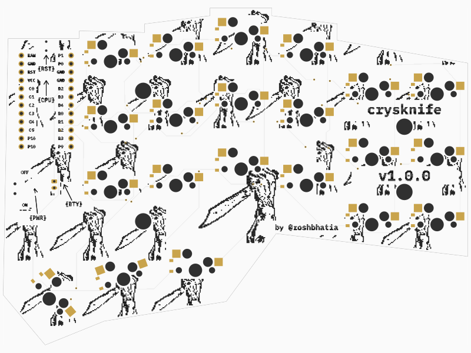
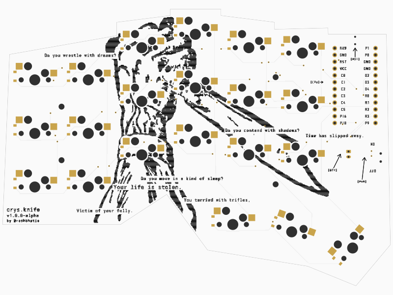
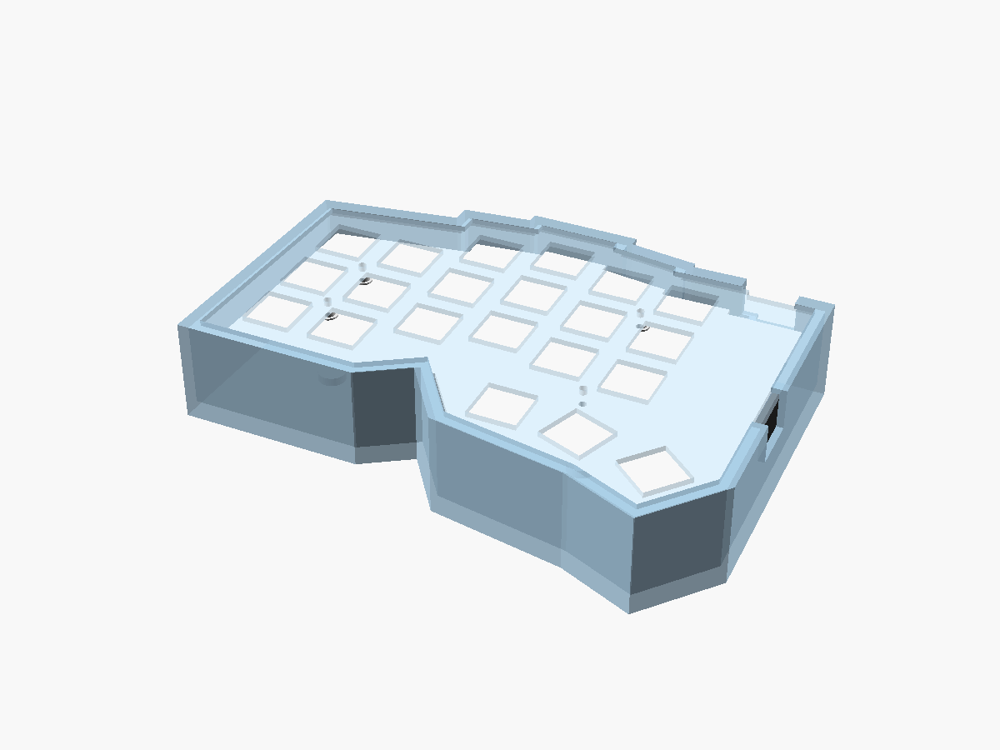

# crysknife

A 42-key wireless split keyboard with MX hotswap sockets, ZMK firmware, and a 750 mAh battery in each half.
It uses nice!nano V2 controllers, white PCBs, and a knife illustration and poem lines on both PCB faces.

## PCB

<details open>
<summary>Front</summary>


</details>

<details>
<summary>Back</summary>




</details>

## Case

Each half uses two rigid plates, four M2 standoffs, and a removable TPU sleeve.
The sleeve has a closed bottom and a lip that grips the top plate. USB, power, and reset have side openings.

The printed version uses translucent resin plates. The top keeps 1.6 mm switch seats and adds a narrow underside rim.
Flat acrylic tops and aluminum bottoms are an alternative from SendCutSend.



Compare [four enclosure alternatives](manufacturing/enclosures/README.md): CNC plates with TPU, CNC trays, printed cases, and gasket hybrids.

## Edit the design

- [Layout](ergogen/layout.yaml): key spacing and column stagger.
- [PCB models](tscircuit/README.md#edit-the-models): open either half in the tscircuit editor.
- [Case model](case/sandwich.scad): open in OpenSCAD; dimensions live in [parameters.scad](case/parameters.scad).
- [Artwork](assets/knife.svg): the original knife illustration. All PCB text uses Ioskeley Mono Bold.

[previews/](previews/) contains images of both PCB faces and the case.
[out/](out/README.md) contains checked KiCad projects, schematics, firmware, and 3D models.

## Build

Enter the Nix shell, then install the locked dependencies:

```sh
nix develop .
npm ci
npm ci --prefix tscircuit
```

Generate the boards, artwork, routing, schematics, and case:

```sh
npm run pcb
python3 scripts/add_artwork.py
npm run route
python3 scripts/check_electrical.py
python3 scripts/generate_schematic.py
python3 scripts/generate_assembly.py
python3 scripts/check_assembly_guards.py
python3 scripts/check_supplier_placement.py
npm run case
python3 scripts/check_case_models.py
python3 scripts/export_printed_case.py
python3 scripts/save_previews.py
```

Ergogen generates the layout. tscircuit routes the boards. KiCad checks the finished copper and schematic in GitHub Actions.
A separate workflow builds the left, right, and settings-reset firmware.

## Assembly and ordering

JLCPCB files are in [manufacturing/jlcpcb/](manufacturing/jlcpcb/README.md).
SendCutSend files are in [manufacturing/sendcutsend/](manufacturing/sendcutsend/README.md).
Printed case files are in [manufacturing/jlc3dp/](manufacturing/jlc3dp/README.md).
The [assembly guide](manufacturing/README.md) lists parts, controller headers, battery connections, and soldering work.
