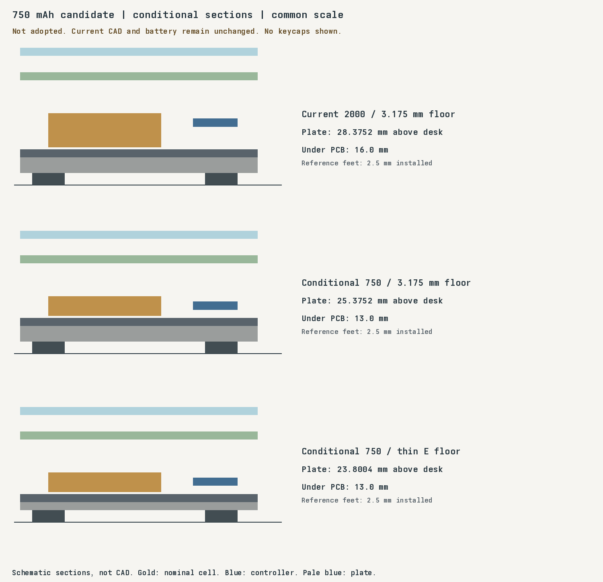

# 750 mAh battery review

The Typeractive 750 mAh pack is a thinner candidate. Adoption remains blocked by missing supplied-pack specifications.
The selected protected Adafruit 2011 pack and all manufacturing CAD remain unchanged. RFQs remain on hold.

## Connector and charging

[Typeractive](https://typeractive.xyz/products/lithium-battery-750mah) lists Liter 403450, 3.7 V, 750 mAh, nominally 50 × 34 × 4 mm.
Its two-pin JST-PH 2.0 mm plug matches the existing S2B-PH-K-S(LF)(SN) connector series.
No PCB connector change is indicated. The “No Jack” option includes the battery plug; the extra jack is unnecessary.

JST1 pin 1 is GND and pin 2 is BAT_P.
The official connector photo suggests matching red/black wiring, but does not specify circuit numbers or guarantee supplied-pack polarity.
Compare the received plug against the [JST drawing](https://www.jst-mfg.com/product/pdf/eng/ePH.pdf) and measure it before connection.
No adapter is anticipated if the supplied pack matches that wiring.
If it differs, select a correctly wired purchased pack or a verified purchased adapter and recheck cable clearance.
Do not repin the live battery plug.

The [Liter 403450 listing](https://bihuade.com/products/37v-403450-750mah-liter-energy-battery-rechargeable-battery-for-smart-phone-dvd-mp3-mp4-led-lamp-camera) specifies 4.2 V charging and protection against overcharge, overdischarge, overcurrent, and shorts.
Typeractive's photo shows a circuit board beneath the tape. These support compatibility but do not identify the supplied protection revision or cutoffs.
Neither listing gives supplied-pack charging-current limits, charging-temperature limits, maximum protected dimensions, or lead length.
Those specifications must confirm 100 mA charging and the reserved envelope before adoption.
The [nice!nano guide](https://nicekeyboards.com/docs/nice-nano/getting-started/) also requires checking battery polarity.

Keep BOOST open and nominal 100 mA charging. The carrier power switch is rated 300 mA.
Protection circuitry does not replace correct charging or the first-article temperature and termination tests.

## Conditional height

If the complete protected pack fits 4 mm nominal thickness, retain the existing 1.5 mm extra battery reservation.
That gives 5.5 mm, plus 0.5 mm foam, 0.5 mm cover/air, 4.4 mm component reservation, and 1.6002 mm floor damping.
A 13 mm under-PCB space leaves the same 0.4998 mm summed allowance as the current 16 mm stack.
This is an envelope calculation, not a measured clearance or a validated swelling specification.
Keep the existing 64 × 40 mm XY reservation until the full pack and cable dimensions are confirmed.

The controller remains face up under the PCB with its 8 mm gap and unchanged pin mapping.
At 13 mm, its board underside sits 1.7998 mm above the floor pad.
The 7.434 mm header drawing lower bound does not prove actual seated height. USB cable fit still needs measurement.

| Construction | Current 2000 mAh | Conditional 750 mAh |
| --- | ---: | ---: |
| Flat 3.175 mm floor, 2.5 mm feet | 28.3752 mm | 25.3752 mm |
| E 1.6002 mm floor, 2.5 mm feet | 26.8004 mm | 23.8004 mm |

Heights measure desk to switch-seat upper surface, without keycaps or screw heads.
The conditional reduction is 3 mm. It needs shorter supports and new sleeve geometry if a sleeve is used.
No smaller-stack STEP/STL files are released because the pack envelope and cable access remain unresolved.

For one working pair, the flat 3.175 mm floor is the simpler stiffness baseline.
E can save another 1.5748 mm, but its thinner floor needs a strength test.
Aluminum requires the existing nonmetal RF window and dielectric battery/controller insulation.
Retain USB/reset/power access, switch-seat thickness, PCB mounts, battery retention without pouch pressure, and antenna clearance.
The A–D alternatives remain available; no enclosure is selected by this review.

## Runtime and sleep

The [pinned ZMK profiler](https://github.com/zmkfirmware/zmk/blob/5b51501fead672c41b5cfb396f3dafe0894bf4e9/docs/src/components/power-estimate.js) predicts the 750 mAh right central at 35–55 days without deep sleep.
It predicts 86–133 days with eight hours awake and sixteen hours actually asleep daily.
These are profiler ranges, not measurements or statistical confidence intervals.
Assumptions include nice!nano V2, one host profile, 2% typing while awake, and no lighting or display.
The left peripheral has lower estimated current; the right central limits pair runtime.
[The generated JSON](battery-750-review.json) includes both capacities, both roles, formulas, and source revisions.
Regenerate with `nix develop --command python3 scripts/review_battery_750.py`.

Both keyboard shields enable [deep sleep](https://zmk.dev/docs/config/power) after fifteen minutes of battery-powered inactivity.
USB power prevents automatic deep sleep. Matrix `wakeup-source` remains enabled; GPIO mappings and central role remain unchanged.
Each sleeping half needs a local keypress. A sleeping right central cannot receive a Bluetooth wake from the left.
Wait for split and host reconnection before typing; the wake press may not reach the host.
Test every local wake key, bonds, reconnect delay, one-sided typing, USB behavior, and sleep current on the assembled pair.
