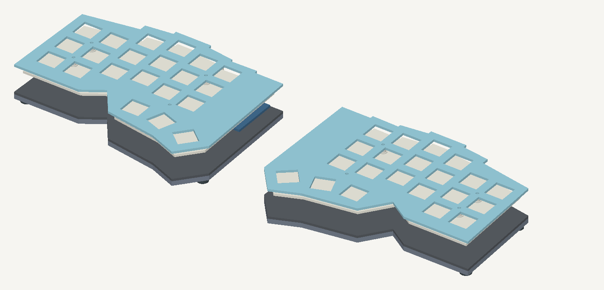

# 750 mAh prototype

The active design adopts two Typeractive Liter 403450 batteries and a 14 mm under-PCB space.
The prototype uses conservative engineering assumptions where supplied-pack limits are unpublished.
No supplier inquiry, quote submission, purchase, or physical qualification occurred.

## Evidence and assumptions

[Typeractive](https://typeractive.xyz/products/lithium-battery-750mah) lists 3.7 V, 750 mAh, nominal 50 × 34 × 4 mm, and a two-pin JST-PH 2.0 mm plug.
The [matching Liter listing](https://bihuade.com/products/37v-403450-750mah-liter-energy-battery-rechargeable-battery-for-smart-phone-dvd-mp3-mp4-led-lamp-camera) specifies 4.2 V charging and protection against overcharge, overdischarge, overcurrent, and shorts.
The Typeractive photo shows a protection board. Exact supplied protection cutoffs and charging limits remain unverified.

Use the “No Jack” battery option. The existing S2B-PH-K-S(LF)(SN) PCB connector stays in place.
With lead entry above the contact windows, the photo maps black to JST circuit 1 and red to circuit 2.
This matches carrier GND/BAT_P and the [JST housing drawing](https://www.jst-mfg.com/product/pdf/eng/ePH.pdf).
Measure the actual plug before connection; a matching shell alone does not prove polarity.
No adapter or repinning is expected. If actual polarity differs, use a correctly wired purchased assembly.

Keep genuine nice!nano V2 BOOST open and nominal 100 mA charging.
That is 0.133 C for this pack, a conservative prototype assumption for the documented rechargeable 4.2 V LiPo.
It stays below the carrier's 300 mA power-switch rating. Published chemistry supports the choice; it does not qualify charging performance.
Use 10–35°C ambient for first charging tests; stop at 40°C cell temperature or a 10°C rise.
These are engineering test limits, not vendor ratings. Measure current, temperature, termination, and low-battery recovery.

## Pack, leads, and retention

| Input | Prototype design value | Basis |
| --- | --- | --- |
| Nominal pack | 50 × 34 × 4 mm | Seller listing |
| Protected-pack bounds | 54 × 38 × 5 mm | Assumption: extra length/width and 1 mm thickness for protection/tolerance |
| Full reservation | 64 × 40 × 6.5 mm | Protected pack plus wire corridor and 1.5 mm vertical growth/fit allowance |
| Lead-end corridor | 10 mm × 38 mm | Loose cable turn and surplus cable; never over the pouch |
| Side corridor | 2 mm | Assumed small insulated lead bundle; measure actual wire/bend fit |
| Foam and dielectric liner | 0.5 mm combined | Existing protection budget; PET liner and soft support |
| Cover and air | 0.5 mm combined | Existing upper insulation budget |

Place the protected pack off-centre within the reservation to leave the full 10 mm lead-end corridor.
Rotate the pack so the leads emerge into that corridor. The arrangement mirrors between halves.
Use loose nonconductive tabs on the protective wrap or side/end stops. Do not screw or strap the pouch down tightly.
The 1.5 mm allowance accommodates design uncertainty; replace a visibly swollen/damaged cell.
If the actual protected pack or cable exceeds these bounds, increase the enclosure before assembly.
Keep the existing battery reservation at least 21.704 mm from the controller RF exclusion.

## Active height and files

The reserved sum is 6.5 + 4.4 + 0.5 + 0.5 + 1.6002 = 13.5002 mm.
A 14 mm under-PCB space leaves 0.4998 mm, preserving the prior nominal stack allowance.
The active supports use 12 mm standoffs plus one 2 mm nylon spacer beneath each PCB mount.
The upper 3 mm spacer and 0.5 mm washer preserve the original 3.5 mm plate gap.

| Datum | Active F | Original flat 2000 mAh |
| --- | ---: | ---: |
| Under PCB | 14 mm | 16 mm |
| Desk to plate top, with reference 2.5 mm feet | 26.3752 mm | 28.3752 mm |
| Controller underside above floor damping | 2.7998 mm | 4.7998 mm |
| Front/plate edge, without keycaps or screw heads | 26.3752 mm | 28.3752 mm |

The reduction is 2 mm, rather than the earlier conditional 3 mm.
The larger protected-pack assumption retains an extra millimetre for uncertainty.
The face-up controller keeps its 8 mm gap; this exceeds the 7.434 mm header drawing lower bound by 0.566 mm.
The lower bound does not prove seated height. Measure actual header seating and USB plug clearance.

The [F package](enclosures/f-750-rigid-sandwich/README.md) contains pair-sized STEP/STL/DXF and hardware files.
It uses a 3.175 mm aluminum floor for stiffness, with a flush PMMA RF insert and outside-only seam retention.
The top stays at 1.6002 mm with unchanged 14 mm switch seats and four PCB mounting positions.
The shortened TPU sleeve remains optional. USB/reset/power windows follow the lower electronics position.
A–E remain separate taller alternatives. No suspended mount or new pointing/display hardware is added.

## Runtime and checks

The [pinned ZMK profiler](https://github.com/zmkfirmware/zmk/blob/5b51501fead672c41b5cfb396f3dafe0894bf4e9/docs/src/components/power-estimate.js) predicts 35–55 days for the right central without sleep.
It predicts 86–133 days with eight hours awake and sixteen hours actually asleep daily.
These are estimates, not measured runtime or confidence intervals.
Assumptions include nice!nano V2, one host profile, 2% typing while awake, and no lighting/display.
[The generated JSON](battery-750-review.json) records both capacities and roles.
ZMK's verified fifteen-minute sleep firmware remains unchanged; wake each sleeping half locally before typing.

Regenerate the review with `nix develop --command python3 scripts/review_battery_750.py`.
Regenerate F with `nix develop .#enclosures --command uv run --locked --project case/variants python case/variants/compact.py`.
The [startup checks](physical-tests.md) cover actual pack/cable fit, polarity, charging, floor/feet, headers, retention, sleep, reconnect, and RF performance.
