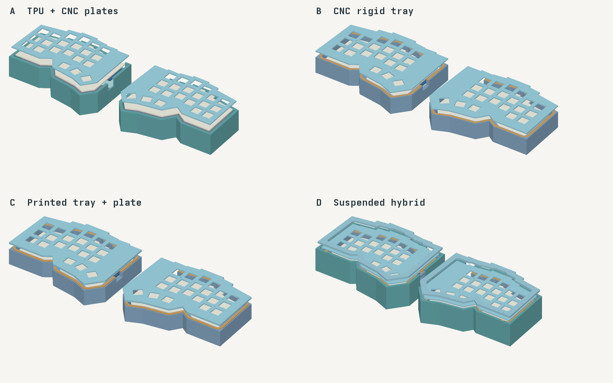
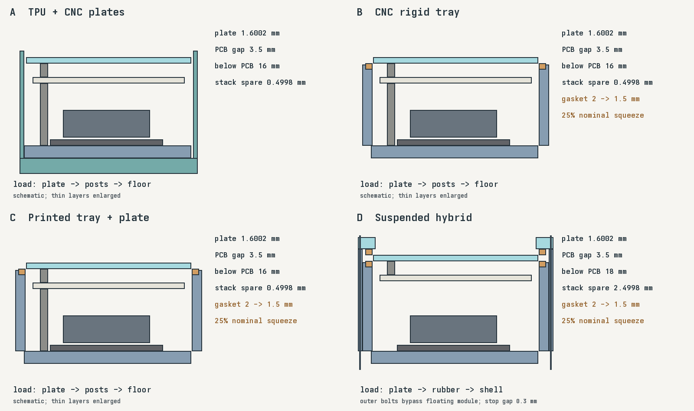

# Enclosure alternatives

Four separate concepts for one complete left/right keyboard pair. No option is selected.
PCB layout, switch centres, 14 mm latch seats, controller orientation, battery position, and firmware remain unchanged.
These packages contain mechanical models and drawings. They do not change PCB assembly files.

| Option | Construction | Support and feel target | Trade-offs |
| --- | --- | --- | --- |
| A: [TPU + CNC plates](a-tpu-cnc-plates/) | CNC PMMA top; aluminum bottom with PMMA RF insert, or full PMMA bottom; original TPU sleeve | Four rigid standoffs. Sleeve provides grip and exterior damping. | Few rigid parts; retains existing sleeve. Thin PMMA and switch retention need a coupon test. |
| B: [CNC tray](b-cnc-rigid-tray/) | Raised aluminum or PMMA tray, separate PMMA top, captured lower gasket | Standoffs set plate height. Gasket compresses against an external ledge. Target: limited plate movement. | More machining and mass. Standoffs bypass the gasket, so this is not suspension. Metal requires a non-metal RF opening. |
| C: [Printed tray + plate](c-printed-tray-plate/) | Translucent resin tray and reinforced resin top; captured lower gasket | Same rigid mounts and compressed perimeter as B | Shows artwork through the case; easier custom geometry. Brittle resin can chip at switch seats and screw holes. |
| D: [Suspended hybrid](d-suspended-hybrid/) | CNC tray, PMMA plate/frame, upper/lower gaskets; optional custom TPU sleeve | Plate and PCB form one floating module. Frame bolts connect only tray to frame. | Better isolation is a hypothesis; more parts and tolerance sensitivity. Adds 2 mm internal height rather than consuming existing clearance. |

A uses the existing TPU sleeve. B and C have wider trays and do not fit it.
D includes a purpose-made sleeve with 0.5 mm nominal side clearance, a closed bottom, and a lip over the fixed frame.
Its lip does not touch the floating plate. Screw access requires sleeve removal.
A useful process hybrid is C's printed tray with B's flat CNC PMMA top: outline, mounting positions, and switch-seat height match.
The unused rim pocket in C's tray remains clear. Keep C's lower gasket and rigid mounting hardware.
Do not combine C's reinforced top with B's tray: B lacks the matching underside rim pocket.

The [assembled-height review](height-review.md) removes the exploded gaps and adds a separate thin-floor candidate.
RFQs remain on hold during that review.

## Images



The exploded renders use actual CAD surfaces and nominal PCB, battery, and controller envelopes.
The original TPU sleeve in A is shown 9 mm below its installed position. Tops are lifted 8 mm; D's frame is lifted 14 mm.
Colours distinguish parts; they do not predict optical clarity, texture, sound, or resin toughness.



Each option also has a CAD cross-section render in `previews/enclosures/*-section.png`.
Those cuts pass through the first PCB mounting hole, at Y = 15.2571 mm.
The support diagram above enlarges thin layers for readability and shows the load paths.

## Clearance and load paths

The baseline has 16 mm from floor surface to PCB underside.
Its reserved stack is 13.9 mm plus a 1.6002 mm damping layer, leaving 0.4998 mm.
That is a nominal model allowance, not a measured free gap everywhere.
The controller has a separate 8 mm reserved gap; the drawing-based header stack minimum is 7.434 mm.

A, B, and C retain the 16 mm floor-to-PCB spacing and the complete floor damping/protection allowance.
B/C gasket grooves occupy an external ledge, outside the PCB outline, not the battery cavity.
No ribs or extra floor layers consume the 0.4998 mm allowance.
C's top reinforcement has its own tray pocket and does not enter the PCB cavity.

B/C use a 3 mm wide gasket, 2 mm free thickness, compressed to 1.5 mm by the existing rigid mounting stack.
The external groove is 1.2 mm deep; gasket projection above the tray rim is 0.3 mm.
The tray rim sits 0.3 mm below the plate. Standoffs, not rubber, set the plate's installed height.
Typing load travels through the plate, rigid posts, and floor; the gasket adds a parallel support path.
This can damp contact noise but cannot isolate vibrations carried by the posts.

D removes all floor-to-PCB standoffs. Four internal fasteners per half connect only plate, upper spacers, and PCB.
The entire module rests between two gasket sets. Four separate outer bolts clamp frame to tray on hard compression stops.
Those bolts sit outside the floating plate. Neither bolts nor TPU create a rigid plate-to-tray path at rest.
The lower hard stop is 0.3 mm below the plate; reaching it ends suspension travel.
D raises the complete module and control windows by 2 mm, giving 18 mm below the PCB and 2.4998 mm stack allowance.
Its PCB-to-plate gap, controller/header orientation, and battery footprint remain unchanged.
Gasket stiffness, preload, and travel require testing; this is not a calculated force-deflection design.

Target gasket compression is 25%. A 2.0 ±0.1 mm gasket and 1.50 ±0.05 mm installed gap produce about 18–31% compression.
Material compression curves and compression set must be checked before treating that target as a stable support force.

## Materials and machining

[Elecrow lists CNC PMMA and aluminum](https://www.elecrow.com/cnc-milling-service.html), with polishing, satin finishing, and anodizing among its treatments.
Clear polished PMMA and satin PMMA are separate finish requests; interior tool marks can remain visible.
Aluminum alloy, anodizing colour, and fit after finishing need explicit quote fields.
TPU, polycarbonate, and powder coating remain unconfirmed for Elecrow; do not include them as accepted capabilities.

[Elecrow describes its unspecified translucent and transparent resins as brittle](https://media-cdn.elecrow.com/3d-printing-service.html).
Request an exact resin grade and post-cure specification. The catalogue's strength number is not a design allowable.
C uses a 1.6002 mm latch seat and a 1 mm underside rim rather than making the switch plate uniformly thicker.
Use broad nylon washers and through hardware, not self-tapped resin threads.

CNC tops retain straight 14 mm latch faces and add 1 mm diameter corner reliefs.
STEP uses exact circular reliefs; DXF outlines approximate curves and serve as cutting references.
The `coupons/` package has 13.9, 14.0, 14.1, and 14.2 mm switch openings for CNC and reinforced resin seats.
Confirm tool access and retention with the actual switches and material before settling the cutout tolerance. The tray cavity uses rounded outward offsets; a deep cavity and small gasket groove need supplier tool review.
STEP is authoritative for three-dimensional pocket depths and control openings.

Conductive bottoms/trays have a conservative RF opening covering the existing 28 × 46 mm controller exclusion.
The matching PMMA insert has 0.25 mm edge clearance and is kept flush with the floor.
Retain it using an underside seam bond or external support, without adding adhesive thickness inside the cavity.
PMMA trays may use the same split geometry, although a supplier may prefer a monolithic non-metal part after review.
Do not bridge the RF opening with metal fasteners or conductive coatings.
The battery envelope remains at least 21.704 mm from the model's RF exclusion.
The opening preserves geometric clearance; it does not prove radio performance inside an aluminum case.

## Files and quantities

Each named left/right part is quantity one. `hardware.csv` lists quantities for one keyboard pair. `materials.csv` keeps material and finish alternatives explicit.
A's `pmma-bottom` replaces `bottom` plus `rf-insert`; do not buy both bottom choices.
D's TPU sleeve is optional. Other D components form the suspended case without it.
Gaskets are supplied as complete cut sets; control openings can split a set into several pieces.

- STEP: CNC bodies, plates, RF inserts, frames, and reference gasket geometry, in millimeters.
- STL: printed bodies/plates/sleeves and geometric references for the other parts, in millimeters.
- DXF: plate profiles and uncompressed gasket cutting profiles. Gasket thickness comes from the BOM, not the DXF.
- `checks.json`: actual bounding boxes, solid counts, volumes, and nominal clearance calculations.
- `parts.csv`: per-part dimensions and quote quantities, with alternatives marked.

Request general CNC tolerance ±0.10 mm; gasket-height and switch-seat datums ±0.05 mm as quote targets.
Printed tolerance, shrinkage, and finishing allowances need supplier values. These targets are not supplier commitments.
Confirm finished M2 holes, 1.6002 mm latch thickness, mating clearances, corner reliefs, and datum faces on the drawing review.

The reported $254.71 Elecrow quote has unresolved dimensions and quantities and excludes major components.
It is not a complete landed cost for any option here. Import duties are unconfirmed.
Price comparisons need the same pair quantity, exact files, material/finish, hardware, gaskets, controllers, batteries, switches, keycaps, assembly, shipping, and duties.
JLC's component placement offsets and rotations are model-specific. Elecrow must independently approve all 94 placements and polarity before assembly.
No supplier was contacted and no quote or order was submitted for these variants.

## Checks and physical tests

The generator validates CAD solids and STEP round-trip volumes, keeps gasket pockets outside the PCB, and checks battery/RF spacing.
The validation script checks installed-part overlaps, mirrored volumes, and closed STL triangle edges.
D checks frame/keycap clearance and verifies outer bolts do not cross the floating plate.
Original PCB, firmware, and assembly exports are unchanged.

Test actual header insertion/height, USB cable clearance, battery retention and insulation, switch latch retention, and key travel.
Measure fit after cure/finish, gasket compression and creep, tray/frame warping, screw engagement, and TPU installation force.
Check D for incidental hard contact throughout travel, including wires, battery, controller, screws, and the RF insert.
Compare typing force, plate movement, sound, and wireless reconnect/range with the complete case.
Run the existing electrical, charging, and Bluetooth startup checks after mechanical assembly.

## Regenerate

```sh
nix develop .#enclosures
uv sync --project case/variants --locked --python python3.12
uv run --locked --project case/variants python case/variants/generate.py
uv run --locked --project case/variants python case/variants/coupons.py
uv run --locked --project case/variants python case/variants/validate.py
uv run --locked --project case/variants python case/variants/present.py
```

`case/geometry.scad` and `case/parameters.scad` remain the shared source for the existing layout and stack.
Edit `case/variants/generate.py` for alternatives. CAD dependencies are locked in `case/variants/uv.lock`.
