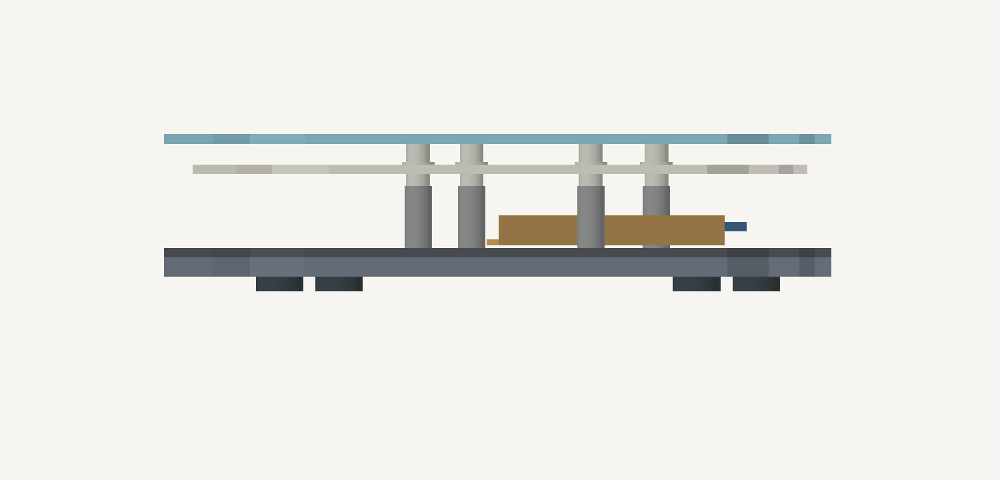
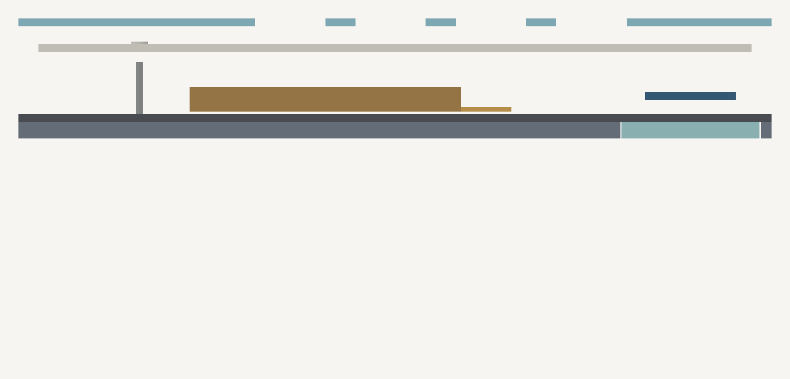

# F: 750 mAh rigid sandwich

Active prototype for one left/right pair: clear top, aluminum floor with a PMMA RF insert, flat damping sheet, and four rigid mounts per half.
The optional TPU sleeve uses the same smaller stack. The floor damping does not suspend the plate.

Use [parts.csv](parts.csv) for quantities, materials, and model dimensions; each left/right part is quantity one.
Use [hardware.csv](hardware.csv) for one pair's hardware, controllers, headers, and batteries.
STEP describes installed geometry and height. STL uses millimetres. DXF describes flat profiles; thickness comes from the BOM.
The top is a laser-cut 1.6002 mm acrylic sheet with square 14 mm switch seats.
CNC milling needs a separate tool/corner-relief review; use the existing switch coupons before choosing a milling tolerance.
No case or PCB key positions move.

The 3.175 mm aluminum floor retains the 28 × 46 mm controller exclusion as a nonmetal opening.
Seat the PMMA insert flush, leaving 0.25 mm edge clearance. Retain it only along the exterior seam with nonconductive adhesive/support.
Keep metal fasteners and conductive coating out of the RF opening.
The supplied foam/liner and cover budgets already include battery insulation. Do not add interior ribs or stacked foam.

The PCB sits 14 mm above the floor: 12 mm standoffs plus one 2 mm nylon spacer per mount.
[Würth 960020010](https://www.we-online.com/components/products/datasheet/960020010.pdf) specifies 2.0 ±0.1 mm length, 4 mm diameter, and a 2.2 mm bore.
[Würth 970120244](https://www.we-online.com/components/products/datasheet/970120244.pdf) has a 12 mm body, 4 mm flats, and a through M2 thread.
Top M2 × 12 screws engage by 2.7998 mm; bottom M2 × 6 screws engage by 2.325 mm nominally.
Their combined engagement is well below the 12 mm through-thread length.
Reference feet stand 2.5 mm above the desk; keep each bottom head and washer at or below 2.1 mm.
Measure loaded foot height and floor stability. Feet are not yet a selected product.

[checks.json](checks.json) records STEP round-trip volumes, closed STL edges, mirrored part volumes, clearance, battery/wire bounds, and screw engagement.
The modeled plate top is 26.3752 mm above the desk, 2 mm lower than the old flat stack.
The protected battery block is a 54 × 38 × 5 mm assumption, not a vendor model.
The amber region shows reserved cable space; actual routing remains a physical check.
The remaining under-PCB allowance is 0.4998 mm. Controller underside clearance above the damping pad is 2.7998 mm.
Physical header, cable, pack, switch, material, and RF tests remain in [startup checks](../../physical-tests.md).

The [battery review](../../battery-750-review.md) contains the published evidence and conservative charging/pack assumptions.
Supplier quotes and existing cart entries must use these files and the current sleep-enabled firmware; earlier taller packets are stale.
No supplier communication or order has occurred.
