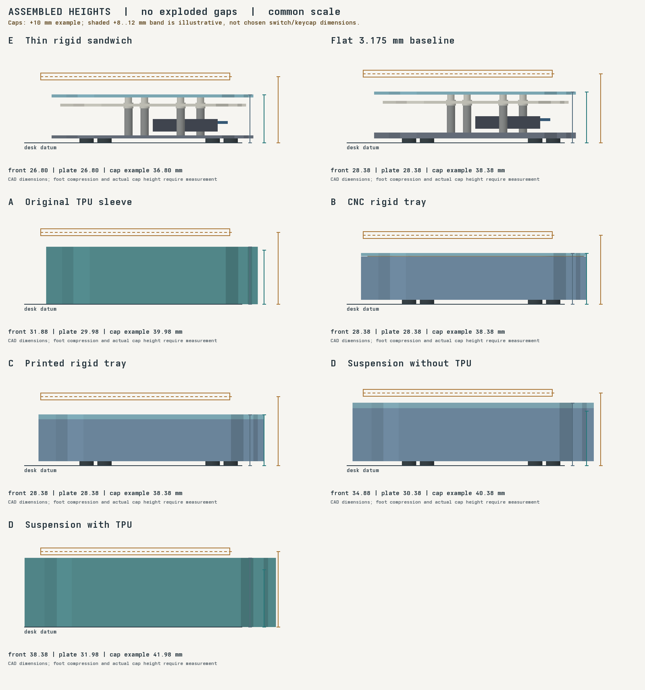
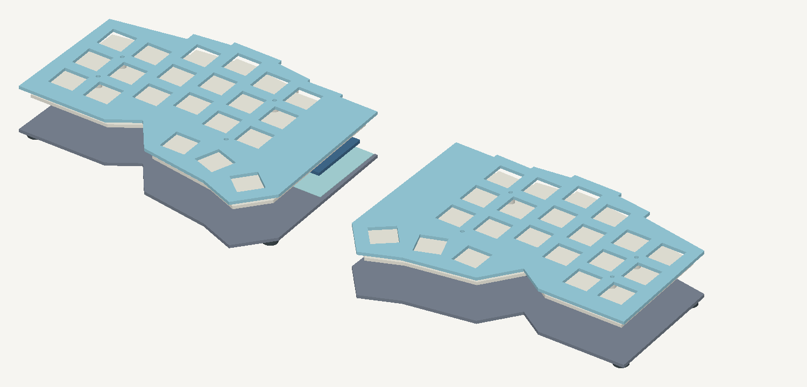

# Original 2000 mAh height comparison

This archived comparison records A–E with the original 2000 mAh envelope.
The current [F prototype](f-750-rigid-sandwich/README.md) uses 750 mAh and a lower 14 mm stack.
The original comparison geometries remain separate. RFQs remain on hold.
The earlier image was exploded: A's sleeve moved down 9 mm, tops moved up 8 mm, and D's frame moved up 14 mm.
Those gaps are not part of the installed keyboard.

The lowest modeled current-electronics candidate is [E: thin rigid sandwich](e-thin-rigid-sandwich/).
It keeps the full 16 mm under-PCB allowance, uses a 1.6002 mm aluminum floor, and omits a tall tray and TPU exterior.
It is a geometric candidate for a prototype, not a physically qualified construction.
The thinner floor needs a stiffness/handling test before a manufacturing choice.



All profiles use the same scale, installed CAD positions, and no exploded gaps.
The left view represents either half; each pair has the same vertical dimensions.
The warm band is an illustrative switch/keycap envelope, not a selected cap or measured Outemu dimension.

## Datums

- Desk: reference contact plane at rest. Feet are modeled at 2.5 mm installed height; their actual SKU/compression is unknown.
- TPU desk contact: the closed sole is 4.1 mm thick. No extra feet are added in those views.
- Front edge: the highest exterior shell or plate edge within 1 mm of the frontmost contour, at minimum design Y.
- Plate: the upper surface of the 1.6002 mm switch latch seat.
- Example cap top: plate height plus H = 10 mm. The shaded band uses H = 8–12 mm only as an illustration.

Measure H on the actual Outemu switch and chosen keycap assembly from the plate's upper surface.
Do not infer H from keycap overall height or call the illustrative band a fit specification.
Front-edge measurements exclude keycaps and removable screw heads.
Top screw heads may extend above the body; their final profile depends on the selected hardware.
Foot heights include their adhesive and require loaded measurements. The 2.5 mm foot target leaves 0.4 mm below a maximum 2.1 mm bottom head/washer stack.

| Construction | Desk to front edge | Desk to plate top | Example cap top, H = 10 mm |
| --- | ---: | ---: | ---: |
| E: thin rigid sandwich | 26.8004 mm | 26.8004 mm | 36.8004 mm |
| Existing flat 3.175 mm base, reference feet | 28.3752 mm | 28.3752 mm | 38.3752 mm |
| A: original TPU sleeve | 31.8752 mm | 29.9752 mm | 39.9752 mm |
| B: rigid CNC tray, reference feet | 28.3752 mm | 28.3752 mm | 38.3752 mm |
| C: rigid resin tray, reference feet | 28.3752 mm | 28.3752 mm | 38.3752 mm |
| D: suspended, reference feet | 34.8752 mm | 30.3752 mm | 40.3752 mm |
| D: suspended with TPU | 38.3752 mm | 31.9752 mm | 41.9752 mm |

`height-review.json` and `height-review.csv` store the calculated datums and assumptions.
A front edge includes its retaining lip. D's front frame edge sits above the floating plate.
The bodies can look different while sharing the same switch-plate height.

## What limits height

The 13.9 mm stack is a conservative sum used by the generator:
4.4 mm underside-component reservation + 8.5 mm protected battery envelope + 0.5 mm foam + 0.5 mm insulating cover/air.
Adding the existing 1.6002 mm floor damping pad gives 15.5002 mm under the PCB.
The 16 mm design leaves 0.4998 mm nominal allowance.
This sum is not a demonstrated collision of measured components, but its protection margins cannot be treated as free material to remove.
The battery is nominally 60 × 36 × 7 mm; the larger reserved envelope and padding remain unchanged.

The controller is face up beneath the PCB. Its gap remains 8 mm.
The HCTL receiver / Mill-Max male header drawing-based minimum body stack is 7.434 mm; full seated height is unmeasured.
With the 1.6 mm controller PCB and floor pad, 4.7998 mm remains between controller board underside and the pad in the current model.
That independent controller clearance does not justify reducing the battery/component reservation elsewhere.
The carrier-to-plate gap stays 3.5 mm. Changing it requires actual switch/body/socket measurements and retention checks.

D adds 2 mm under the PCB, two compressed gasket layers, a fixed frame, and optional TPU around that frame.
It is the tallest option, and suspension is unnecessary if minimum height is the priority.
Its current outer frame bolts also cluster toward one side; compression distribution and frame stiffness need review before manufacturing.
No gasket or rib is added inside E's existing cavity.

## E: thinner floor and simpler exterior



E replaces only the 3.175 mm floor with 1.6002 mm stock and changes bottom screws from M2 × 6 to M2 × 4.
[SendCutSend lists .063 inch 5052 H32 aluminum](https://sendcutsend.com/materials/5052-aluminum/).
The floor retains a non-metal RF opening, flush PMMA insert, dielectric protection, and the existing damping pad.
Use an underside-only seam bond or external retention for the insert; add no new thickness above the floor.
The open sandwich retains side access to USB, reset, and power.
Secure the protected battery and cover wires/pins within the existing allowance; no tall shell is required for the geometric stack.

Four original PCB mounts, 15 mm standoffs plus 1 mm shim, upper spacers, switch centres, and latch seats remain unchanged.
Bottom screw engagement computes to 1.8998 mm; upper engagement remains 3.7998 mm.
The selected screw and washer stack must meet the 2.1 mm head limit, with adequate thread depth and no protrusion into electronics.
The foot-position references clear screw heads and the RF opening and surround the PCB centroid.
They are placement references, not supplied rubber feet.

E reduces plate height by 1.5748 mm versus the existing flat base with the same feet, or 3.1748 mm versus A with its TPU sole.
Its front edge is 5.0748 mm below A's lip. Relative to D with TPU, its plate is 5.1748 mm lower.
These differences are calculated dimensions, not measured ergonomic benefits.
At equal alloy and outline, thickness-cubed scaling gives about 12.8% of the old floor's bending stiffness.
That estimate is not a load test; the RF opening and insert also affect stiffness.
Test bowing under typing/handling, pressure against the cell, retention of the insert, and corner stability.

The supplier also lists .040 inch stock, but its availability does not prove a thinner floor supports this battery/PCB safely.
A 1.02 mm floor would save only another 0.5802 mm and would reduce the thickness-based stiffness substantially.
Flush countersunk bottom screws could permit lower feet, but need a selected screw drawing, countersink design, and thin-floor pull-through tests.
Neither change is included in E. We do not spend the internal 0.4998 mm allowance.

## Height, cost, and component alternatives

| Change | Height effect | Cost / assembly consequence |
| --- | --- | --- |
| E, flat laser-cut plates and short bottom screws | Computed 26.8004 mm plate height | Removes CNC tray/frame, perimeter gaskets and TPU printing; still requires feet, liners, battery retainers and RF insert. Total price is unquoted. |
| Keep existing thick flat base, omit TPU | Plate 28.3752 mm with the reference feet | Simplest reversible exterior change; retains existing base stiffness. |
| Move the same battery outside the key field | Could remove the battery stack constraint locally; controller still limits height | Requires new retention/cable/port layout and a larger footprint or side pod. Current files do not implement it. |
| Use a thinner/smaller battery | Could reduce the battery reservation after datasheet and physical checks | Changes capacity/runtime, sourcing and qualification. Not compatible with the current 2000 mAh requirement without a user decision. |
| Replace machine sockets with lower mounting/direct soldering | Could reduce controller mounting height after measurements | Loses easy controller removal; changes carrier fit, assembly process and rework. No lower header is substituted. |
| Relocate controller above the carrier | Does not fit the current 3.5 mm plate gap with the selected receiver/header stack | Needs a raised local cover or different assembly. Flipping the module can change pin mapping and is not an accepted shortcut. |
| Custom integrated controller/charging PCB | Could remove the stacked module/socket assembly | New PCB/firmware/RF/charging work and qualification; substantial development cost for one pair. |

Complete-pair electronics and work remain unchanged: two nice!nano V2 modules, four male strips/48 solder joints, two protected batteries, 42 switches and keycaps, flashing and tests.
Keep BOOST open for nominal 100 mA; the ALPS switch is rated 300 mA.
The $254.71 Elecrow quote still lacks resolved dimensions, quantities, major components and duties, so it cannot rank total working-pair costs.
RFQs remain on hold while height/material choices and first-article tests are reviewed. No supplier was contacted.

## Regenerate and test

```sh
nix develop .#enclosures
uv run --locked --project case/variants python case/variants/lower.py
uv run --locked --project case/variants python case/variants/height_review.py
```

E has separate STEP/STL/DXF files, a per-pair `hardware.csv`, foot references, and `checks.json`.
The original A–D manufacturing geometry stays unchanged.
Check the real header insertion/height, cable sweep, feet under load, floor flex, battery pressure/insulation, switch/keycap retention, and RF range.
Complete electrical, key-matrix, charging and Bluetooth tests before treating any assembled pair as working hardware.
